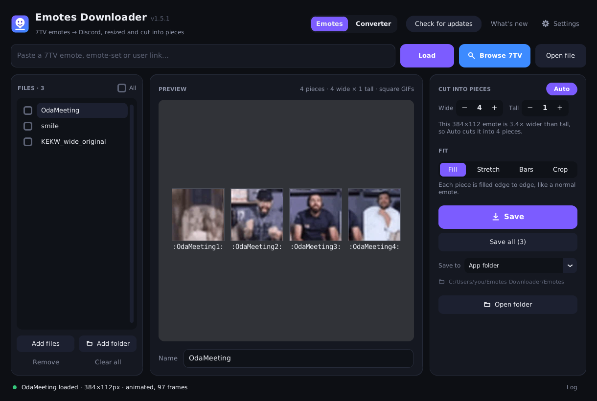
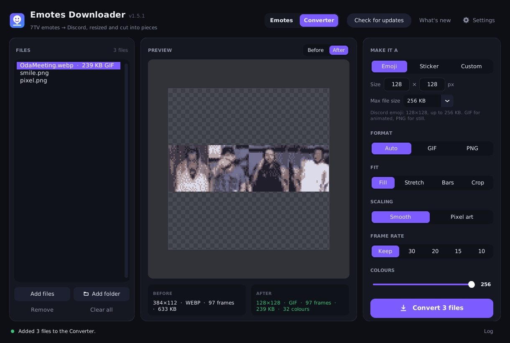
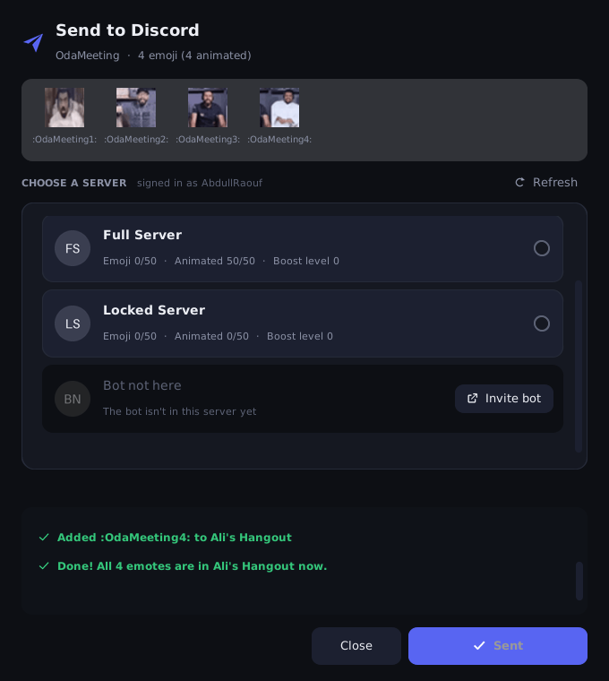
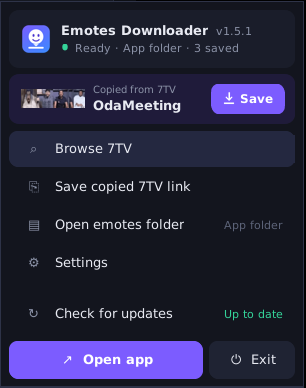
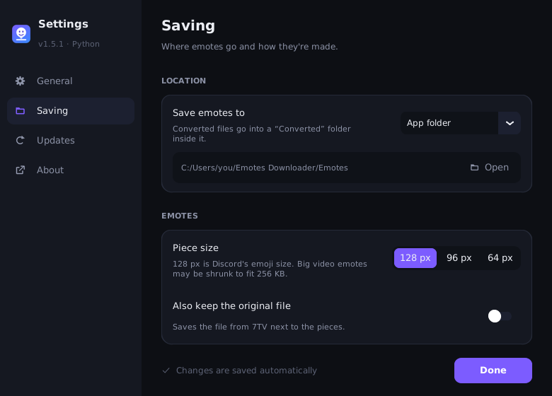

# Emotes Downloader

**7TV emotes → Discord, resized and cut into pieces.** Made by [ISdook](https://github.com/ISdook).

Emotes Downloader gets emotes from 7TV and turns them into files you can add as Discord emoji. It works with both animated and static emotes. Each file comes out at 128 px and under Discord's 256 KB limit. It can also cut wide or big emotes into pieces like `:OdaMeeting1::OdaMeeting2::OdaMeeting3:`.

It also has a built-in **Converter** for your own images, GIFs and videos, so you never have to upload them to a random website. Everything runs on your own PC.

**[⬇ Download the latest version](https://github.com/ISdook/emotes-downloader/releases/latest)**



---

## Features

| | |
|---|---|
| **Browse 7TV in the app** | Search 7TV, or look through Trending, Top and New. One click saves an emote, already sized for Discord. |
| **Paste or copy a link** | Paste a 7TV emote, emote set or user link. Or just copy a link on 7tv.app, and the app notices it and offers **Save now**. |
| **Cut big emotes into pieces** | **Auto** cuts wide emotes into square pieces, for example a 384×112 emote into `:OdaMeeting1:` to `:OdaMeeting4:`. You can also pick your own grid. |
| **Emoji or sticker** | Choose **Emoji** (128×128, up to 256 KB, cut into pieces) or **Sticker** (exactly 320×320, up to 512 KB). Animated files become GIF and still ones PNG, keeping every frame whenever possible. |
| **Converter** | Make an emoji, a sticker or any custom size from images, GIFs or videos, with your own size, fit, colours, frame rate and pixel-art scaling. |
| **Drag and drop** | Drop files, whole folders or 7TV links anywhere on the window. |
| **Send to Discord** | Log in with Discord and the bot adds finished emotes and stickers to your servers in one click, with a green or red result for each one. |
| **Files panel** | Collect lots of files or emotes, then save them all at once. |
| **Tray icon** | Keeps running in the system tray, with a quick panel for saving copied links, browsing and updates. |
| **Auto-updates** | Updates itself from GitHub releases and shows what's new after each update. |

---

## Download and install

Get the files from the **[latest release](https://github.com/ISdook/emotes-downloader/releases/latest)**. Pick one:

| File | Best for |
|---|---|
| **Emotes-Downloader-Setup.exe** | Most people. Installs the app with a Start menu shortcut (and a desktop one if you want). It installs for your user only, so no admin is needed. |
| **Emotes-Downloader-Portable.exe** | No install. One file you can run from anywhere, even a USB stick. |
| **Emotes-Downloader-Python.zip** | Running from source. Unzip it and double-click `run.bat`. You need [Python](https://www.python.org/downloads/) with "Add python.exe to PATH" ticked. The first run installs the libraries it needs. |

It runs on Windows 10 and 11 (64-bit).

> The first time you open it, Windows may say **"Windows protected your PC"**, because the app isn't code-signed. Click **More info → Run anyway**.

---

## Emotes tab: 7TV to Discord

1. **Get emotes.** There are four ways:
   - **Browse 7TV**: search, or look through Trending / Top / New. Press **Save** on an emote to save it right away, or **Open** to check the cut first.
   - **Paste a link** into the box and press **Load**. This works with:
     - an emote: `https://7tv.app/emotes/<id>`
     - an emote set: `https://7tv.app/emote-sets/<id>` (every emote in the set)
     - a user: `https://7tv.app/users/<id>` (their active set)
     - just an emote ID
   - **Copy a link** on [7tv.app](https://7tv.app/emotes). A bar pops up with **Save now**.
   - **Your own files**: use **Add files** / **Add folder** in the Files panel, or drag them onto the window. Images, GIFs and videos all work.
2. **Emoji or sticker?** Choose at the top of the right panel:
   - **Emoji**: 128×128 pieces, up to 256 KB each. Big emotes are cut into pieces.
   - **Sticker**: one image, exactly 320×320 and up to 512 KB, the size Discord needs. Stickers are sent one per message, so they're never cut. They're saved in a `Stickers` folder.
3. **Check the cut** (emoji). The preview shows each piece separately with its `:name:` under it.
   - **Auto** picks how many square pieces the emote needs, so each one fills a full-height square. Press **Auto** again to turn it off.
   - Use **Wide / Tall** to choose the grid yourself, for example 2 × 2 for a big emote.
4. **Pick how it fits:**
   - **Fill** (default): fills each piece edge to edge.
   - **Stretch**: always stretches.
   - **Bars**: adds transparent bars so nothing is cut off.
   - **Crop**: trims the edges.
5. **Choose where it's saved** with **Save to**:
   - **App folder** (default): an `Emotes` folder next to the app.
   - **Downloads**, **Pictures** or **Desktop**.
   - **Custom folder…**: any folder you pick.
   - The Files list handles thousands of files. Use ↑ ↓ to go through them, Space to tick, Delete to remove and Ctrl+A to tick all. Shift+click a box to tick a range.
6. **Press Save.**
   - With several files in the list, **Save all** saves them all.
   - If you tick some, it becomes **Save selected** and saves only those.
7. **Add them to Discord.**
   - The easy way: press **Send to Discord** and pick a server (see [Send to Discord](#send-to-discord)).
   - By hand, emoji: upload the pieces in Server Settings → Emoji, then type them next to each other: `:OdaMeeting1::OdaMeeting2::OdaMeeting3::OdaMeeting4:`.
   - By hand, stickers: upload them in Server Settings → Stickers.

---

## Converter: do it yourself, on your own PC



The **Converter** tab is for when you want full control and don't want to upload your files to some random website. It accepts PNG, JPG, GIF, WebP, AVIF, BMP and videos (MP4, WebM, MOV, MKV…).

1. **Add files.** Drop files or a whole folder on the window, or use **Add files** / **Add folder**.
2. **Pick what to make:**
   - **Emoji**: 128×128, up to 256 KB.
   - **Sticker**: 320×320, up to 512 KB.
   - **Custom**: any size and file size limit, up to "No limit".
3. **Fine-tune:**
   - **Format**: **Auto**, **GIF** or **PNG**. Auto picks GIF for animated files and PNG for still ones.
   - **Fit**: Fill, Stretch, Bars or Crop.
   - **Scaling**: Smooth, or **Pixel art** to keep hard pixel edges.
   - **Frame rate**: keep it, or lower it to 30 / 20 / 15 / 10 fps for smaller files.
   - **Colours**: 8 to 256.
4. **Check the preview.** Switch between **Before** and **After**. The final size shows green when it's under the limit and orange when it's still over.
5. **Press Convert.** Files are saved to a `Converted` folder inside your save folder.

**About videos:** the first time you open a video, the app offers a one-time download of **ffmpeg**, a free and widely used video tool. It's about 40 MB, from PyPI, the official Python package site. Images and GIFs never need it.

---

## Send to Discord



Press **Send to Discord** on the Emotes tab (or in the Converter). It sends:
- **every emote you ticked** in the Files list (the button says how many, for example **Send 15 to Discord**)
- or, if nothing is ticked, the emote you're looking at (a cut emote sends all its pieces)

The app saves them first, then opens the panel:
- **Left:** the emotes that will be sent. Click a name to rename it (emoji names can only use letters, numbers and `_`, 2–32 characters), or press **×** to leave one out.
- **Right:** every server where you're allowed to add emojis:
  - **In colour:** your bot is in that server. You'll see the free emoji, animated and sticker slots, and a red warning if they won't all fit.
  - **Dark:** the bot isn't there yet. Press **Invite bot** to add it.

Pick a server and press **Send**. The emotes go one by one, and each gets a ✓ or ✗ and a line under **Results**:
- **green** when it's added
- **red** with the reason when it isn't, for example no free slots or a name Discord doesn't accept. One failing never stops the others.

If Discord asks the app to slow down, it waits and shows a countdown. Press **Stop** any time. Afterwards **Send** only sends the ones that aren't added yet, so you can fix a name or pick another server and press it again.

### Log in with Discord (one click)

Open **Settings → Discord** (or press **Discord settings** under **Send to Discord**) and press **Log in with Discord**. Your browser opens Discord's login page: press **Authorize** and you're done. There's no bot to set up.

- The public bot **Emotes Downloader** adds the emotes. It can only add and manage emojis and stickers.
- You only see your own servers: servers where the bot is (ready to send) and servers where you can invite it (dark, with an **Invite bot** button that opens right on that server).
- The Emotes Downloader server checks your permission in that server for every single emote, so nobody can use the bot on a server that isn't theirs.
- **Switch account** and **Log out** are in the same place.

### Dashboard website and /emote command

You don't even need the app for quick ones:
- **Website:** [emotes-downloader.isdook.workers.dev](https://emotes-downloader.isdook.workers.dev). Log in with Discord, pick a server, paste a 7TV link or drop image files. You can also see all the server's emojis and free slots, rename or delete emojis, and see who added what.
- **In Discord:** type `/emote add` and paste a 7TV link (you need the Manage Expressions or Create Expressions permission).

Wide emotes are cut into pieces by themselves, both on the website and with `/emote add`: KEKW becomes `:KEKW1: :KEKW2: :KEKW3: :KEKW4:`. Type the pieces together, with no spaces, to show the whole emote. Don't want that? Untick **Cut wide emotes into pieces** on the website, or use `/emote add cut:False`. Each piece needs a free emoji slot.

The website also shows how many servers use the bot, live. The bot's profile has the same count, a link to this page and the developer's name (ISdook).

For stickers, your own files and big batches, use the app.

## Tray icon



When you close the window, the app keeps running in the system tray. You can turn this off in Settings.

- **Left-click** the tray icon to open the app.
- **Right-click** it to open the tray panel. It shows:
  - the app's status
  - the last copied 7TV emote, with a **Save** button
  - **Browse 7TV**, **Open emotes folder** and **Settings**
  - the update status
  - **Open app** and **Exit**

---

## Settings



Changes save instantly.

| Page | Options |
|---|---|
| **General** | Keep running in the tray · Start with Windows · Notice copied 7TV links |
| **Saving** | Save location · Piece size (128 / 96 / 64 px) · Also keep the original file |
| **Discord** | Log in with Discord · Switch account · Log out · Invite the bot · Dashboard website · Open "Send to Discord" after saving |
| **Updates** | Check for updates on start · Install updates automatically · Check now · What's new |
| **About** | Version, GitHub link, settings file location, reset all settings |

---

## Updates

- On start, the app checks this repo's latest release. By default it installs a new version by itself and restarts. The button at the top shows **Up to date**, or **Update to vX** with download progress.
- After every update, a **What's new** window shows the changes. The full history is in **[CHANGELOG.md](CHANGELOG.md)**.
- Each version updates the matching way:
  - **Installed**: runs the new setup quietly.
  - **Portable**: swaps in the new `.exe`.
  - **Python**: updates `emotes_downloader.py` and keeps the old one as `.bak`.

---

## How the files are made

- **Formats:** animated emotes become GIF and still ones PNG. These are the formats Discord accepts for emoji and stickers.
- **Stickers:** always exactly 320×320. To get under 512 KB, only colours and frames are reduced, never the size. Animated stickers are cut to 5 seconds, Discord's limit.
- **Staying under 256 KB:** the app keeps every frame and shrinks the piece first, to 96, 72, 64 or 48 px. Discord shows emotes at 48 px at most, so they still look sharp. Frames are dropped only as a last resort.
- **Video-like emotes:** the app stores only what changes between frames, which leaves room for more detail.
- **Cut emotes:** every piece gets the same settings, so the pieces animate in sync. Each cut emote gets its own folder.
- **Names:** they follow Discord's rules: letters, numbers and `_`, 2 to 32 characters.

## Privacy

Everything runs on your PC. The app only connects to:
- **7TV**, to find and download emotes
- **GitHub**, to check for updates
- **PyPI**, only if you choose to download video support
- **Discord and the Emotes Downloader server** (`emotes-downloader.isdook.workers.dev`), only if you log in with Discord, and only for the servers and emotes you choose. The website's [privacy policy](https://emotes-downloader.isdook.workers.dev/privacy) says what it stores

Your Discord login is stored encrypted on your PC (Windows DPAPI). Your other files are never uploaded anywhere.

## Tips

- In Discord, a message with only emotes shows them bigger, which is the best way to show off a cut emote.
- Your server needs **one emoji slot per piece**. Animated pieces use animated slots.
- 7TV's biggest files are 128 px tall, so a 2×2 version of a square emote is upscaled and looks a bit softer.

## Troubleshooting

- **"Windows protected your PC":** click **More info → Run anyway**. It shows because the app isn't code-signed.
- **A file is still over 256 KB** (shown in orange): lower the frame rate or colours in the Converter, or use fewer pieces.
- **A video won't open:** accept the one-time video support download when the app asks.
- **Send to Discord shows a red line:** the line says why. The usual reasons are no free slots, or that you or the bot are missing the **Manage Expressions** permission in that server.
- **Discord login doesn't finish:** close other copies of the app (they use the same login port) and try again. Your browser must be able to open `http://127.0.0.1:53682`.
- **Update now doesn't work:** the app shows a window with the reason, plus **Try again** and **Download it myself**. With the portable version, keep the app in a normal folder like Documents or Desktop (not Program Files). If a very old version can't update itself, download the latest version once from the [releases page](https://github.com/ISdook/emotes-downloader/releases/latest).
- **Something went wrong:** click **Log** at the bottom right of the app to see what happened. You can also [open an issue](https://github.com/ISdook/emotes-downloader/issues).

---

## Command line (optional)

```
python emotes_downloader.py https://7tv.app/emotes/<id> --split auto
python emotes_downloader.py <emote-id> --split 2x2 --fit cover --name BigKEKW
python emotes_downloader.py https://7tv.app/emote-sets/<id> --out "D:\Emotes"
python emotes_downloader.py <emote-id> --sticker
python emotes_downloader.py --update
```

## For the maintainer: releasing a new version

1. Change `__version__` near the top of `emotes_downloader.py`, for example to `"1.6.0"`.
2. Add a section at the top of **CHANGELOG.md**:
   ```
   ## v1.6.0 — 2026-12-01
   - What changed
   ```
   The build refuses to run without it. This text becomes the release notes and the app's "What's new" window.
3. Commit and push.
4. On GitHub, open **Releases → Draft a new release**, create the tag `v1.6.0` and publish it.

GitHub Actions then builds the portable `.exe`, the setup `.exe` and the Python zip, and attaches them to the release.

To build locally on Windows, run `build_exe.bat`. The setup `.exe` also needs [Inno Setup 6](https://jrsoftware.org/isdl.php).
